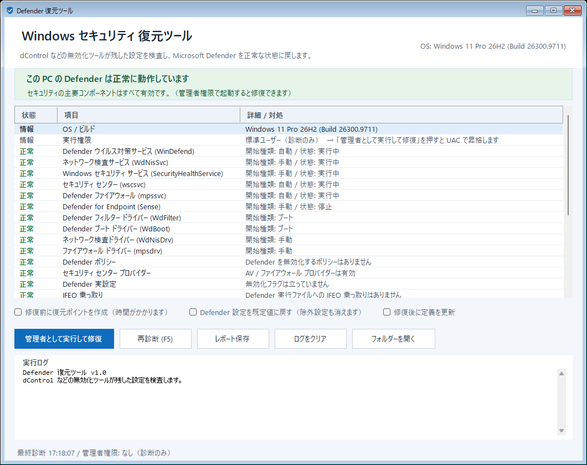

# DefenderRestore

**A portable Windows tool that diagnoses and restores Microsoft Defender after it has been disabled, broken, or tampered with by tools such as [dControl (Defender Control)](https://www.sordum.org/9480/defender-control-v2-1/).**

[](https://github.com/4uthen7/defender-restore/actions/workflows/build.yml)
[](https://github.com/4uthen7/defender-restore/releases)
[](LICENSE)
[](#requirements)
[](#requirements)

> **This tool only enables and repairs Defender.** It never disables real-time protection, cloud protection, automatic sample submission, or tamper protection. Those protections are intentionally not automated here.

[日本語の README はこちら](README.ja.md)

---

## Table of contents

- [Why this exists](#why-this-exists)
- [Quick start](#quick-start)
- [What it checks](#what-it-checks)
- [What it repairs](#what-it-repairs)
- [Health-check commands](#health-check-commands)
- [How to read the results](#how-to-read-the-results)
- [What to do after the check](#what-to-do-after-the-check)
- [Error 1058 and the Windows Security UI](#error-1058-and-the-windows-security-ui)
- [Why dControl cannot re-enable Defender](#why-dcontrol-cannot-re-enable-defender)
- [CLI](#cli)
- [Build](#build)
- [Project layout](#project-layout)
- [Requirements](#requirements)
- [Limitations and safety](#limitations-and-safety)
- [FAQ](#faq)
- [Contributing](#contributing)
- [License](#license)

---

## Why this exists

Tools like **dControl v2.1** were designed for Windows 10 and early Windows 11. On current Windows builds they often fail halfway:

- they disable `WinDefend`, `wscsvc`, or `SecurityHealthService`,
- they leave `DisableAntiSpyware` / `DisableAntiVirus` policies behind,
- they break service ACLs, `ImagePath`, or the Windows Security app registration,
- and their "enable" button then cannot undo the damage.

The result is a PC where Defender's engine may be running, but **Windows Security shows no options** — or where the services are disabled and a reboot alone does not bring them back.

DefenderRestore is a small, dependency-free WinForms tool that audits all of those layers and repairs them in the correct order. It was built and tested on Windows 11 26H2, and has also been run on Windows 10 22H2.

---

## Quick start

1. Download **`DefenderRestore.exe`** from the [latest release](https://github.com/4uthen7/defender-restore/releases/latest).
2. Put it in a **local folder** (for example `C:\Users\<you>\Downloads\DefenderRestore`). Do **not** run it from OneDrive — the .NET Framework may refuse to load an assembly from a cloud-backed folder.
3. Double-click `DefenderRestore.exe`.
4. If the banner is red or yellow, click **"管理者として実行して修復"** and approve the UAC prompt.
5. The tool repairs, re-diagnoses, and shows what changed. Reboot if it says a reboot is required.
6. Re-run the health-check commands below to confirm.



### One-click repair

The release ZIP also contains `one-click-repair.bat` (Japanese: `ワンクリック修復.bat`). Double-click it and approve UAC; it runs:

```text
DefenderRestore.exe --repair --yes
```

which performs diagnosis → elevation → repair without an extra confirmation dialog.

---

## What it checks

| Area | Details |
|---|---|
| OS / build / privilege | Windows version, build, UBR, admin status |
| Services | `WinDefend`, `WdNisSvc`, `SecurityHealthService`, `wscsvc`, `mpssvc`, `Sense` |
| Service configuration | `Start` value, dependencies, running state (also written to the report) |
| Drivers | `WdFilter`, `WdBoot`, `WdNisDrv`, `mpsdrv` |
| Policies | `HKLM\SOFTWARE\Policies\Microsoft\Windows Defender` and nested subkeys, including `Policy Manager` |
| Real config | `DisableAntiSpyware`, `DisableAntiVirus`, `DisableRealtimeMonitoring` |
| Security Center providers | `Disabled` flag under `HKLM\SOFTWARE\Microsoft\Security Center\Provider\Av` / `Fw` |
| IFEO | `Debugger` hijacks for Defender executables |
| Registry ACL | Explicit `Deny` entries on Defender-related keys (admin only) |
| Tamper Protection | On/off state (read-only; never changed by this tool) |
| Engine | WMI `MSFT_MpComputerStatus`: antivirus, real-time, mode, signature age |
| Windows Security app | `Microsoft.SecHealthUI` package + `windowsdefender:` protocol registration |
| Platform | `MsMpEng.exe` under `C:\ProgramData\Microsoft\Windows Defender\Platform` |
| dControl leftovers | Exclusions, running process, leftover folder |
| Firewall | Domain / Standard / Public profile state |

---

## What it repairs

1. Deletes Defender-disabling policies, including nested subkeys.
2. Resets `DisableAntiSpyware` / `DisableAntiVirus` / `DisableRealtimeMonitoring` to `0`.
3. Re-enables Security Center AV/FW providers whose `Disabled` value was set.
4. Removes explicit `Deny` ACL entries **before** touching services.
5. Restores service start types:
   - `WinDefend` → Automatic
   - `WdNisSvc`, `SecurityHealthService`, `Sense` → Manual
   - `wscsvc`, `mpssvc` → Automatic
6. Repairs a broken `WinDefend` `ImagePath` if `MsMpEng.exe` moved.
7. Restores driver start types (`WdFilter` / `WdBoot` = Boot, `WdNisDrv` / `mpsdrv` = Manual).
8. Removes IFEO `Debugger` values.
9. Removes dControl exclusions that point at dControl.
10. Re-registers the Windows Security app when its protocol contract is missing.
11. Turns the firewall back on if a profile was disabled.
12. Starts the services and re-diagnoses.
13. Optionally creates a restore point, runs `MpCmdRun.exe -RestoreDefaults`, or updates signatures.

> **Tamper Protection is never disabled.** If it is on and Windows blocks a change, the tool reports the failure; it does not try to bypass it. Disable Tamper Protection manually in Windows Security only if you understand the risk.

---

## Health-check commands

Run **PowerShell as Administrator** (right-click Start → Terminal (Admin) / PowerShell (Admin)).

### 1. Engine status

```powershell
Get-MpComputerStatus |
  Select-Object AntivirusEnabled, RealTimeProtectionEnabled, IsTamperProtected,
                AMRunningMode, AntivirusSignatureAge, AntivirusSignatureVersion
```

Healthy output looks like:

```text
AntivirusEnabled          : True
RealTimeProtectionEnabled : True
IsTamperProtected         : True
AMRunningMode             : Normal
AntivirusSignatureAge     : 0
```

### 2. Defender preferences

```powershell
Get-MpPreference |
  Select-Object DisableRealtimeMonitoring, DisableIOAVProtection,
                DisableBehaviorMonitoring, DisableScriptScanning
```

Healthy: all `False`.

### 3. Services

```powershell
Get-Service WinDefend, WdNisSvc, SecurityHealthService, wscsvc, mpssvc, Sense -ErrorAction SilentlyContinue |
  Select-Object Name, Status, StartType
```

Expected on Windows 10/11:

| Service | Status | StartType |
|---|---|---|
| `WinDefend` | Running | Automatic |
| `WdNisSvc` | Running | Manual |
| `SecurityHealthService` | Running | Manual |
| `wscsvc` | Running | Automatic |
| `mpssvc` | Running | Automatic |
| `Sense` | Stopped (consumer PCs) | Manual |

### 4. Raw service configuration

```powershell
sc.exe qc WinDefend
sc.exe qc SecurityHealthService
sc.exe qc wscsvc
```

Look at `START_TYPE`:

- `2 AUTO_START` — good
- `3 DEMAND_START` — good
- `4 DISABLED` — bad; the service will not start, even after a reboot

### 5. Policy leftovers

```powershell
reg query "HKLM\SOFTWARE\Policies\Microsoft\Windows Defender" /s
```

A healthy machine has no `DisableAntiSpyware=1`, `DisableAntiVirus=1`, or real-time protection disables. An empty result (or only `Policy Manager`) is normal.

### 6. Windows Security app

```powershell
Get-AppxPackage *SecHealthUI* | Select-Object Name, Version, Status
Get-AppxPackage *SecHealthUI* | Select-Object -ExpandProperty InstallLocation
```

`Status : Ok` is good. If the package is missing or broken, the Settings page may show only an "Open Windows Security" button.

### 7. Firewall

```powershell
Get-NetFirewallProfile | Select-Object Name, Enabled
```

All profiles should be `True`.

---

## How to read the results

| What you see | What it means | What to do |
|---|---|---|
| `AntivirusEnabled : True`, `RealTimeProtectionEnabled : True` | Engine is on | Nothing |
| `RealTimeProtectionEnabled : False` | Protection is off | Run DefenderRestore as admin, reboot, re-check |
| `IsTamperProtected : True` | Good | Nothing |
| `IsTamperProtected : False` | Tamper Protection is off | Enable it in Windows Security (the tool cannot) |
| `WinDefend` StartType `Disabled` | Service disabled | Run the tool; if it cannot change it, use `sc.exe config` + reboot |
| `wscsvc` / `SecurityHealthService` stopped | Windows Security UI may be blank | Start the services; if 1058, see below |
| `DisableRealtimeMonitoring : True` | Policy/preference disables protection | Run the tool |
| Policy key contains `DisableAntiSpyware=1` | dControl-style policy | Run the tool |
| `Get-AppxPackage` missing | Windows Security app missing | Re-register / reinstall |
| Firewall profile `Enabled : False` | Firewall off | Run the tool |

---

## What to do after the check

### Case 1 — everything is green

You are done. Re-run the checks after Windows updates or after using any "Defender disabler".

### Case 2 — engine or real-time protection is off

1. Run `DefenderRestore.exe` as Administrator.
2. Click **Repair**.
3. Reboot if prompted.
4. Re-run the health checks.

### Case 3 — a service is `DISABLED`

Run an **Administrator** command prompt:

```cmd
sc.exe config WinDefend start= auto
sc.exe config wscsvc start= auto
sc.exe config SecurityHealthService start= demand
sc.exe config WdNisSvc start= demand
sc.exe config mpssvc start= auto
```

Then reboot. Do not expect a disabled service to come back by itself.

### Case 4 — a service is Auto/Manual but stopped

```cmd
sc.exe start wscsvc
sc.exe start SecurityHealthService
sc.exe start WinDefend
```

If it starts, re-open Windows Security. If it stops again, check Event Viewer → Windows Logs → System for Service Control Manager errors (`7000`, `7001`, `7031`, `7034`).

### Case 5 — error 1058

See [Error 1058](#error-1058-and-the-windows-security-ui).

### Case 6 — Windows Security still shows no options

1. Confirm `wscsvc` and `SecurityHealthService` are **Running**.
2. Restart Explorer or sign out/in.
3. Re-register the app:

```powershell
Get-AppxPackage -AllUsers *SecHealthUI* |
  ForEach-Object {
    Add-AppxPackage -DisableDevelopmentMode -Register (Join-Path $_.InstallLocation 'AppxManifest.xml')
  }
```

4. Reboot.

### Case 7 — Tamper Protection is off

The tool cannot turn it on. Open **Windows Security → Virus & threat protection → Manage settings → Tamper Protection** and enable it.

### Case 8 — a company/school PC

Group Policy or Intune may override local settings. Run `gpresult /h report.html` and talk to your administrator before changing policies.

---

## Error 1058 and the Windows Security UI

`ERROR_SERVICE_DISABLED (1058)` means:

> The service cannot be started, either because it is disabled or because it has no enabled devices associated with it.

Common causes and fixes:

1. **`START_TYPE : 4 DISABLED`**  
   Set it to `demand`/`auto` and reboot.

2. **`START_TYPE` is already `2` or `3`, but 1058 persists**  
   The Service Control Manager (SCM) is still holding the old "disabled" state. This happens when the start type was changed through the registry rather than through `ChangeServiceConfig`. **Reboot**, then run the tool again. If the tool logged "registry fallback / reboot required", this is exactly the case.

3. **Dependency problem**  
   Check `DEPENDENCIES` in `sc.exe qc`. `wscsvc` and `SecurityHealthService` depend on `RpcSs`; `WdNisSvc` depends on `WdNisDrv`; `mpssvc` depends on `mpsdrv`, `bfe`, `nsi`. Start the dependencies first.

4. **Missing or damaged binary**  
   Check `C:\Windows\System32\SecurityHealthService.exe` and `svchost.exe`. Run:

   ```cmd
   sfc /scannow
   DISM /Online /Cleanup-Image /RestoreHealth
   ```

5. **Tamper Protection / policy**  
   If a change is blocked, the tool reports it. Do not fight Tamper Protection; adjust it in the UI or ask the administrator.

> `wscsvc` is a **delayed automatic** service. After a reboot it can take 2–3 minutes to start. Do not panic if it is still `Stopped` immediately after login.

---

## Why dControl cannot re-enable Defender

1. **Tamper Protection deadlock**  
   dControl requires Tamper Protection to be turned off manually. Once Defender is disabled, the Windows Security app/service may no longer open, so you cannot turn it back on. While it is on, Windows rejects dControl's registry and service changes.

2. **Windows 11 22H2+ ignores `DisableAntiSpyware`**  
   On client SKUs the policy is no longer honored. dControl 2.1 (March 2022) predates this change, so its status display and the real Defender state diverge.

3. **Partial enable**  
   dControl's enable path is "delete policy → set service to Automatic → start". If any step is blocked by ACL/TP/dependencies, it stops midway and the UI stays "off".

4. **New platform layout**  
   Defender now lives under `C:\ProgramData\Microsoft\Windows Defender\Platform\...\MsMpEng.exe`; dControl still expects `C:\Program Files\Windows Defender\MSASCui.exe`, which does not exist on Windows 11.

5. **dControl is often quarantined**  
   Defender frequently flags dControl as a HackTool. The binary may be deleted, so the enable button cannot run.

---

## CLI

```text
DefenderRestore.exe                     # GUI, diagnose only
DefenderRestore.exe --repair --yes      # diagnose -> elevate -> repair
DefenderRestore.exe --report <path>     # write a diagnostic report and exit
```

`--report` works without administrator rights, but ACL checks are skipped.

---

## Build

Requirements: Windows with .NET Framework 4.x (4.8 recommended). No Visual Studio or NuGet packages are needed.

```powershell
git clone https://github.com/4uthen7/defender-restore.git
cd defender-restore
powershell -ExecutionPolicy Bypass -File .\build.ps1
```

Output: `dist\DefenderRestore.exe`.

Manual build:

```powershell
$csc = "$env:windir\Microsoft.NET\Framework64\v4.0.30319\csc.exe"
& $csc /nologo /target:winexe /platform:anycpu /optimize+ /codepage:65001 `
  /win32manifest:src\app.manifest /win32icon:src\app.ico /out:dist\DefenderRestore.exe `
  /r:System.dll /r:System.Core.dll /r:System.Drawing.dll /r:System.Windows.Forms.dll `
  /r:System.Management.dll /r:System.Security.dll `
  src\Core.cs src\MainForm.cs src\AssemblyInfo.cs
```

---

## Project layout

```text
.
├─ src/
│  ├─ Core.cs            # diagnostics + repair engine
│  ├─ MainForm.cs        # WinForms UI + CLI entry point
│  ├─ AssemblyInfo.cs    # version metadata
│  ├─ app.manifest       # DPI / OS compatibility
│  └─ app.ico            # icon
├─ docs/
│  ├─ screenshot.png
│  ├─ security-overview.png
│  └─ threat-page.png
├─ samples/
│  └─ sample_report.txt
├─ tools/
│  └─ one-click-repair.bat
├─ build.ps1
├─ README.md
├─ README.ja.md
├─ CHANGELOG.md
├─ SECURITY.md
└─ LICENSE
```

---

## Requirements

- Windows 7 SP1 / 8 / 8.1 / 10 / 11 (best tested on Windows 10 22H2 and Windows 11 26H2)
- .NET Framework 4.8 (included in Windows 10 1903+ and Windows 11; install it on older systems)
- Administrator rights for repair
- Local disk execution (not OneDrive / network share)

---

## Limitations and safety

- **It never disables protections.** Requests to add global real-time/cloud/sample-submission/Tamper-Protection disables are out of scope.
- **Tamper Protection cannot be disabled programmatically.** Only the Windows Security UI can change it, and Windows may re-enable it automatically.
- **Some repairs need a reboot.** Driver start types and SCM start-type changes are applied at boot.
- **Unsigned binary.** SmartScreen may warn on first launch; verify the SHA-256 in `SHA256.txt`.
- **Managed PCs.** Group Policy/Intune may override local repair. Ask your administrator.
- **Back up first.** Use the optional restore point or create one manually.

---

## FAQ

**Does this disable Defender?**  
No. It only enables and repairs.

**Does it turn off Tamper Protection?**  
No. That is intentionally not implemented.

**Will a reboot restore the Windows Security options?**  
Only if the services' start types are correct (`2`/`3`) and the app registration is intact. A service set to `4 DISABLED` will stay off after a reboot. See [What to do after the check](#what-to-do-after-the-check).

**Why does it refuse to run from OneDrive?**  
The .NET Framework blocks assembly execution from cloud-backed/remote locations by default. Run it from `Downloads` or another local folder.

**Does it work on Windows 7?**  
The tool detects and skips components that do not exist on older builds, but Windows 7/8.1 require .NET Framework 4.8 and are out of support by Microsoft. Windows 10/11 are the primary targets.

---

## Contributing

Issues and pull requests are welcome, especially:

- additional dControl/Defender-disabler leftovers,
- localized error messages,
- reports from Windows builds not listed above.

Please do **not** submit features that disable Defender protections, Tamper Protection, or Cloud protection. They will be rejected.

---

## License

[MIT](LICENSE) © 2026 4uthen7

This project is not affiliated with Microsoft or Sordum. Microsoft Defender is a trademark of Microsoft Corporation.
